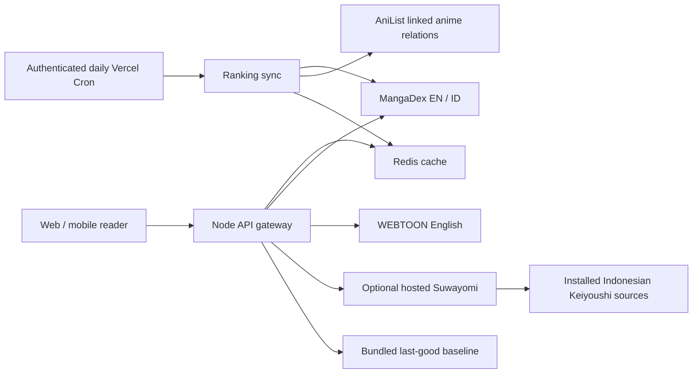

# INKRUSH reader architecture and implementation roadmap

Deployment update: the reader, gateway and persistent Suwayomi backend now run on Railway and deploy from GitHub `main`. See [RAILWAY.md](RAILWAY.md) for the current services, verification and operations. The original Vercel architecture below remains an optional deployment path; Redis and scheduled ranking refresh have not been provisioned.

## Implemented in this revision

The maintained application is a vanilla JavaScript mobile/desktop reader with Node.js 24 Vercel Functions. Keep this stack for this release; migrating its working UI to Next.js adds no immediate value. The existing Next/Sites scaffold is separate from the deployed `public/` reader. No soundtrack code is shipped.

- Compact numbered chapter tiles, matching the supplied second image. The whole tile is a button; title, volume and date remain available in its accessible name/tooltip. Search, sort, saved/current markers, chapter zero, decimals, specials and stable source indexes are retained.
- WEBTOON-only Page/Strip switch. Strip uses native vertical scrolling inside the reading canvas, stacks chapter images, retries individual failed images and has explicit chapter navigation at the end. Normal manga retains page reading. Preference and image/fractional position are stored locally.
- MangaDex English and Bahasa Indonesia editions. Catalog uses `availableTranslatedLanguage[]=id`; chapter feeds use `translatedLanguage[]=id`. Indonesian manga IDs are `md:id:<uuid>`, so saved progress and chapter metadata never mix with English editions. A catalog availability flag does not guarantee every chapter has public images; unavailable/external/empty chapters remain filtered.
- Unified `/api/gateway` dispatches MangaDex, WEBTOON and an optional server-side Suwayomi backend. MangaDex and WEBTOON run now; Suwayomi runs after configuration. Existing direct local Suwayomi connection remains available through Sources.
- Real baseline daily-ranking snapshots for both languages, generated with `node scripts/seed-trending.mjs`. They include provider follower counts and linked AniList adaptation statuses. User requests read snapshots rather than calling AniList. Without Redis, snapshots refresh when regenerated and deployed; they are NOT automatically updated daily.
- Redis REST cache, coalesced cache misses per instance, authenticated daily cron, distributed worker lease, partial-provider failure isolation and last-good ranking retention are implemented. They activate after the environment variables below are configured.

## Request path and normalized contract



Public routes:

| Request | Result |
|---|---|
| `/api/gateway?action=sources` | `{sources:[{id,name,lang}]}` |
| `/api/gateway?action=catalog&source=mangadex-id&category=trending&page=1` | `{mangas,hasNextPage,ranking?}` |
| `/api/gateway?action=manga&id=md:id:<uuid>` | manga plus normalized `chapters` |
| `/api/gateway?action=pages&id=<chapter-id>` | `{pages:[same-origin-image-URL]}` |
| `/api/trending?language=id&page=1` | cached ranked Indonesian manga |
| `/api/trending-sync` | authenticated cron; never called from the UI |

Manga shape: `{id,title,poster,description,author,genre,translatedLanguage?,originalLanguage?,status?,sourceLabel?,sourceUrl?,chapters?}`. Chapter shape: `{id,name,chapterNumber,pageCount?,publishedAt?,volume?,alternativeIds?}`. Preserve native source identifiers; never merge different translations on title alone. WEBTOON uses `wt:` IDs; server Suwayomi uses `sw:s:`, `sw:m:` and `sw:c:`. Exact canonical links are the future cross-source merge key.

## Trending formula

For title i, using two observations separated by d days:

`v_i = max(0, followers_now - followers_previous) / d`

Use velocity only when the same title has a previous observation and `0.75 <= d <= 8`. This prevents repeated refreshes from overstating growth and stale snapshots from masquerading as daily movement. The source follower count is global; it is not an Indonesian-specific readership count. Rank the English and Indonesian candidate pools independently.

For each pool, normalize positive velocity and total followers with:

`N(x) = min(1, log(1 + max(0,x)) / P95(log(1+x_pool)))`

The divisor defaults to 1 if the pool is empty/all zero. A freshness term is `F = exp(-age_days / 14)` using MangaDex metadata update time (not a measured read count). Invalid dates get zero freshness.

When velocity exists:

`S = 80 * (0.65*N(v) + 0.20*N(followers) + 0.15*F) + A`

Cold start or missing history renormalizes available weights:

`S_baseline = 80 * (0.20*N(followers) + 0.15*F) / 0.35 + A`

`A = 20` for a linked adaptation with anime status `RELEASING`; `A = 10` for `NOT_YET_RELEASED`; otherwise `A = 0`. Use the maximum boost, never add multiple seasons together. Score is bounded to 0–100. Ties use stable IDs. `scoreDetails.baseline`, `animeChecked` and `velocity:null` expose missing evidence instead of inventing it.

Candidate collection unions 30 most-followed titles and 30 recently chapter-updated titles per language, using MangaDex's safe and suggestive ratings. The same rating policy applies to search and ordinary catalog browsing; mainstream series such as One Piece and One-Punch Man are classified as suggestive by MangaDex and would disappear under a safe-only filter. Erotica and pornographic ratings are excluded. This is a bounded discovery sample, not a whole-catalog ranking. Both pools are queried once per sync. Follower statistics are fetched as a batch. Anime matching follows MangaDex's exact `links.al` AniList manga IDs and `ADAPTATION` relations of type `ANIME`; no fuzzy title search earns a boost. AniList relations are cached for six hours. A metadata outage keeps ordinary popularity scores and records metadata failures.

Bookmark velocity and daily/weekly aggregate reads are deliberately not fabricated: the currently connected public sources do not supply those series, and library bookmarks are local browser data. A future trusted read-event collector can add distinct-user daily reads, 7-day EMA growth and bookmark deltas, with per-source percentile normalization and authenticated deduplication. Do not send local reading history to third parties to obtain ranking signals.

## Cache and sync policy

| Data | TTL / retention |
|---|---|
| MangaDex normalized catalog/details | 120 seconds, CDN stale-while-revalidate 300s |
| Suwayomi catalog/details/source list | 300 seconds |
| Page URL manifests | 60 seconds, permitting expiring CDN URLs to refresh |
| Image responses | 24 hours, source-specific allowlists |
| AniList relations per bounded ID batch | 6 hours |
| Current ranking + previous observations | 30 days, same JSON document |
| Cron worker lease | 300 seconds, token-checked release |

Cron runs `0 3 * * *` (03:00 UTC / 10:00 Asia/Bangkok). Vercel sends `Authorization: Bearer <CRON_SECRET>`. The handler refuses unauthenticated calls and refuses to sync without durable Redis. It acquires a Redis `SET NX EX` lease, skips language snapshots younger than 20 hours, builds a complete replacement and atomically publishes it with `SET`. On provider failure it retains the old snapshot and returns 502 so the failed job is observable. Publication and historical observations are the same document, avoiding a race between reading the new ranking and the old follower totals. Rankings older than 48 hours return `stale:true`; the UI labels them as saved snapshots.

No caller can request a live rerank from the public feed. In-memory fallback is bounded and coalesces same-key concurrent requests, but is neither shared nor durable across serverless instances. Redis availability is required for durable measured velocity and global sync locking. Add platform WAF/rate limiting for public endpoints before substantial traffic; keep upstream concurrency and bounded candidate size. For a much larger catalog, divide sync into queued per-source/per-language batches and retain at least 8 daily observation buckets for a true weekly signal. The current small sync uses a 60-second function budget; monitor duration and move to a worker if provider latency approaches that limit.

## Image delivery and blocked providers

MangaDex/WEBTOON proxies validate HTTPS, fixed host/path allowlists, no embedded credentials or alternate ports, image content types and redirects. Referrer headers are set only for their own provider. The Suwayomi image proxy accepts only server-owned `/api/v1/manga/<id>/thumbnail`, `/api/v1/manga/<id>/chapter/<index>/page/<number>` and legacy `/api/v1/chapter/<id>/page/<number>` paths; its configured URL and Basic/Bearer credentials stay server-side. The current nested page path was checked against Suwayomi's ChapterMutation implementation. No arbitrary URL proxy is provided.

Komiku, Komikcast and WestManga are not represented as working direct APIs. Install supported Bahasa Indonesia extensions in your own Suwayomi server; the gateway lists installed EN/ID sources and forwards their normalized catalog/chapter/page results. Keep source-specific referrer/cookie processing in Suwayomi. Cloudflare/403/auth/app/paid restrictions produce an actionable provider error or provider link; this app does not attempt to defeat challenges or bypass restricted access. The existing Weeb Central adapter is local-only because Vercel is blocked. A configured extension is not a guarantee that every title or image will be accessible. Test the deployed server from Vercel before enabling it for users.

## Backend setup

See [SOURCE-EVALUATION.md](SOURCE-EVALUATION.md) for the 12 October 2026 checks of the supplied Indonesian API projects, corrected endpoint conventions, and Suwayomi authentication compatibility. None of the four tested public scraper instances returned a usable One Piece search response in that check; they are not enabled in this release.

1. In the Vercel project `inkrush`, install/connect Upstash Redis through Marketplace. Set production `UPSTASH_REDIS_REST_URL` and `UPSTASH_REDIS_REST_TOKEN` as server-side environment variables. The cache uses the official authenticated JSON-array REST command format, so no package install is needed.
2. Set `CRON_SECRET` to a newly generated high-entropy value. Never put it in `public/`, a browser form or source control. Redeploy. Check Vercel Cron is available/enabled for your plan. The schedule is already in the generated `vercel.json`.
3. Run the sync once from a trusted backend client with the Authorization header, or wait for the scheduled job. Confirm `results` contains `updated`/`fresh` for both languages. A baseline snapshot younger than 20 hours is skipped, and the next day provides the first measured velocity. Test an upstream outage; the old feed should remain available.
4. Optional: deploy Suwayomi on an always-on host/container with persistent storage, HTTPS and authentication. Vercel Functions are the gateway, not the long-running extension host. Install Keiyoushi extensions in Suwayomi and enable Indonesian sources you intend to use.
5. Set production `SUWAYOMI_URL=https://your-server.example` plus native Basic credentials `SUWAYOMI_USERNAME` and `SUWAYOMI_PASSWORD`, or `SUWAYOMI_TOKEN` for a Bearer-authenticated reverse proxy. Do not configure both methods. Redeploy, then verify `/api/gateway?action=sources` lists the installed Indonesian sources. Credentials stay server-side and are never put in image query parameters.
6. In Discover choose the new source, search a known title, open its chapter grid and verify a decoded page. The free local setup now verifies Komiku chapter 1 images for One Piece, One Punch Man and Solo Leveling. No hosted Suwayomi instance has been provisioned; hosted acceptance testing is still required.

For the free local Windows setup, use `Start INKRUSH.cmd`; see [LOCAL-SUWAYOMI.md](LOCAL-SUWAYOMI.md) for verified sources, restart instructions and the future Railway migration. Without Redis use `node scripts/seed-trending.mjs` to regenerate snapshots and `node scripts/prepare-vercel.mjs` to package a new deployment. Do not regenerate snapshots repeatedly within a day to manufacture follower velocity.

## Project directory structure

```text
public/
  reader.html, app.js        Reader, gestures, local saved progress
  browse.js, browse-core.js  Discover, predictive search and numbered chapter grid
  reader-modes.css           Chapter tiles and responsive strip UI
  webtoon-strip.js           Native continuous webtoon reading
  sources.js                Normalized browser gateway clients
  mangadex.js, api.js        MangaDex normalization and Suwayomi GraphQL client
lib/
  gateway.mjs               Server-side dispatch / optional Suwayomi image proxy
  cache.mjs                 Upstash REST cache + bounded in-memory fallback
  ranking.mjs               Pure, tested score calculation
  trending.mjs              Candidate collection, AniList enrichment, cron/feed handlers
  data/trending-{en,id}.json Real bundled baseline snapshots
  mangadex-*.mjs            Restricted metadata/image providers
  webtoons.mjs               Public English WEBTOON provider
scripts/
  seed-trending.mjs          Generate real snapshots from upstream APIs
  prepare-vercel.mjs         Package public files, API wrappers and daily cron
  prepare-local.mjs          Package the local reader and setup scripts
  start-local.mjs/.ps1       Start loopback-only reader and portable Suwayomi
  setup-suwayomi.ps1         Download and checksum the pinned official server
tests/                      Existing reader/provider tests plus ranking/gateway tests
docs/ARCHITECTURE.md         This design, formula, setup and rollout plan
outputs/inkrush-vercel/      Generated deployable package; not maintained source
archive/soundtrack/          Deferred feature, excluded from production
```

## Rollout roadmap

1. **Shipped UI and primary language support:** numbered chapter grid, WEBTOON strip mode, MangaDex EN/ID editions and separated progress.
2. **Shipped ranking baseline:** bounded candidate engine, actual follower observations, exact adaptation matching, cache-only feed, failure-safe baseline snapshots.
3. **Ready for operator configuration:** connect Redis, set cron secret, deploy Suwayomi with Indonesian extensions, then perform real backend acceptance tests. Daily auto-refresh and hosted aggregator availability are pending these external services. The local Suwayomi/Komiku flow is verified independently.
4. **Scale after usage evidence:** separate persistent observation store; queued sync batches; source-specific circuit breakers and retry-after backoff; WAF quotas; structured sync failure/duration metrics; canonical cross-source links; optional authenticated AniList tracking. AniList metadata lookup implemented here does not log users in or synchronize their lists.
5. **Future platform migration only if needed:** port the proven contracts/UI into Next.js or a native mobile shell. Keep adapters and ranking domain modules independent so a framework migration does not change saved chapter IDs.

## Primary references

- MangaDex API: https://api.mangadex.org/docs/ (parameter and statistics behavior also verified against live API responses when generating the snapshots).
- AniList GraphQL docs and schema: https://github.com/AniList/ApiV2-GraphQL-Docs (queries validated against the live GraphQL endpoint).
- Suwayomi GraphQL schema: https://github.com/Suwayomi/Suwayomi-VUI/blob/main/schema.graphql
- Upstash Redis REST command format: https://upstash.com/docs/redis/features/restapi
- Vercel cron authentication: https://vercel.com/docs/cron-jobs/manage-cron-jobs
